# iMovies — Cinematic Discovery & Concurrency-Safe Ticket Booking Platform

[](https://opensource.org/licenses/ISC)
[](https://react.dev/)
[](https://expressjs.com/)
[](https://www.mongodb.com/)
[](docs/README.md)

**iMovies** is a full-stack MERN cinema platform featuring real-time movie discovery, interactive curved-screen seat selection, race-condition-safe seat reservations, boarding pass generation, personal wishlists, and studio administration consoles.

---

## Architecture Preview



> 📘 **Full Architecture Documentation**: Detailed technical specifications, data flows, ERD, and sequence diagrams are published in [**`docs/README.md`**](docs/README.md).

---

## Key Features

- **Cinematic Aesthetic**: Tailored dark theme (`#101010` background, `#C62828` crimson accent, and `#F2EFE8` warm off-white typography) inspired by luxury cinema auditoriums.
- **Movie Discovery**: Live multi-field regex search (title, director, description), genre filtering pills, and dynamic sorting by score and latest release.
- **Interactive Seat Selection**: Curved auditorium screen visualization with 2D seating matrices, live price computation, and a maximum 8-seat safety limit.
- **Atomic Concurrency Protection**: Zero double-booking guarantee implemented via atomic single-document MongoDB queries (`findOneAndUpdate` with `$elemMatch` negation and array filters), returning HTTP `409 Conflict` on race conditions.
- **Boarding Pass & Dashboard**: Cinema ticket passes rendered with booking references (`IM-XXXXXX`), scannable barcodes, print capability, and reservation cancellation with instant seat freeing.
- **Personal Wishlist Vault**: Bookmark premiere films for quick future access.
- **Cinema Studio Console**: Executive dashboard with box office gross revenue calculations, catalogue additions/deletions, and showtime schedule generation.
- **Secure Authentication**: Stateless session management via HTTP-only JWT cookies, salted Bcrypt password hashing, and IP rate limiting (100 req / 15 min).

---

## Architecture Diagrams Index

All architecture diagrams are available in editable Mermaid source (`.mmd`) and rendered vector SVG (`.svg`) within [`docs/diagrams/`](docs/diagrams/):

| # | Diagram | Description | Formats |
| :-: | :--- | :--- | :--- |
| **1** | **System Architecture** | Topology of client, tooling, API server, MongoDB collections, and CDNs | [SVG](docs/diagrams/system-architecture.svg) • [MMD](docs/diagrams/system-architecture.mmd) |
| **2** | **Technical Architecture** | File-level mapping between React components, routes, middleware, and controllers | [SVG](docs/diagrams/technical-architecture.svg) • [MMD](docs/diagrams/technical-architecture.mmd) |
| **3** | **Entity-Relationship Diagram** | Mongoose schemas, primary identifiers, foreign keys, and embedded seats | [SVG](docs/diagrams/entity-relationship.svg) • [MMD](docs/diagrams/entity-relationship.mmd) |
| **4** | **Application User Flow** | End-to-end journey from discovery to seat picking, auth redirection, and booking | [SVG](docs/diagrams/user-flow.svg) • [MMD](docs/diagrams/user-flow.mmd) |
| **5** | **Booking & Seat Reservation** | Sequence diagram of the atomic findOneAndUpdate lock, conflict handling, and seat release | [SVG](docs/diagrams/booking-reservation-flow.svg) • [MMD](docs/diagrams/booking-reservation-flow.mmd) |
| **6** | **Backend Architecture Pattern** | Layered Route-Controller-Model REST pipeline analysis with middleware guards | [SVG](docs/diagrams/backend-architecture.svg) • [MMD](docs/diagrams/backend-architecture.mmd) |
| **7A**| **Data Flow Diagram (Level 0)** | Context diagram defining external entities and system boundary | [SVG](docs/diagrams/data-flow-level-0.svg) • [MMD](docs/diagrams/data-flow-level-0.mmd) |
| **7B**| **Data Flow Diagram (Level 1)** | Decomposition into 6 core processes and 5 persistent collections | [SVG](docs/diagrams/data-flow-level-1.svg) • [MMD](docs/diagrams/data-flow-level-1.mmd) |
| **8** | **System Use-Case Diagram** | Actor capabilities for Guest, Registered Patron, and Studio Administrator | [SVG](docs/diagrams/use-case.svg) • [MMD](docs/diagrams/use-case.mmd) |

---

## Quickstart & Installation

### Prerequisites
- [Node.js](https://nodejs.org/) `>= 18.0.0`
- [MongoDB](https://www.mongodb.com/) running locally on port `27017` (or provide `MONGODB_URI` in `backend/.env`)

### 1. Clone & Install Dependencies
```bash
git clone https://github.com/Yug-Tri/Imovies-main.git
cd Imovies-main

# Install root, backend, and frontend dependencies
npm install
npm install --prefix backend
npm install --prefix frontend
```

### 2. Configure Environment Variables
Copy the sample backend environment file:
```bash
cp backend/.env.example backend/.env
```
Default configuration:
```env
PORT=5000
MONGODB_URI=mongodb://localhost:27017/imovies
JWT_SECRET=imovies_jwt_secret_dev_key_2026
FRONTEND_URL=http://localhost:5173
```

### 3. Seed Database
Populate 8 blockbuster films, 3 cinemas, scheduled showtimes with interactive seat layouts, and test accounts:
```bash
npm run seed
```

### 4. Run Development Servers
Start both the Express API and Vite React frontend concurrently:
```bash
npm run dev
```
- **Frontend SPA**: `http://localhost:5173`
- **Backend API**: `http://localhost:5000/api`
- **API Health Check**: `http://localhost:5000/api/health`

---

## Demo Accounts

The seed script creates two pre-configured accounts:

| Role | Email | Password | Access Rights |
| :--- | :--- | :--- | :--- |
| **Patron** | `user@imovies.com` | `UserPass123!` | Ticket booking, wishlist, dashboard, reservation cancellation |
| **Studio Admin** | `admin@imovies.com` | `AdminPass123!` | Executive box office stats, movie CRUD, showtime scheduler |

*(Tip: Use the 1-Click Demo Login buttons on the `/login` page for instant sign-in).*

---

## Running Automated Tests

Run backend integration tests covering registration, login, movie discovery, atomic seat reservations, 409 double-booking rejection, and cancellations:
```bash
npm test
```
Tests run against an isolated in-memory MongoDB instance (`mongodb-memory-server`) with zero external database dependencies.

---

## Regenerating Architecture Diagrams

All 9 diagrams can be recompiled into vector SVGs at any time:
```bash
npm run docs:generate
```
Or directly:
```bash
node docs/scripts/render-diagrams.js
```

---

## Repository Structure

```
Imovies-main/
├── backend/
│   ├── scripts/
│   │   └── seed.js                 # Database seed script
│   ├── src/
│   │   ├── config/db.js            # Mongoose connection setup
│   │   ├── controllers/            # Business & persistence logic
│   │   ├── middleware/             # Auth, role guard, rate limiter, error handler
│   │   ├── models/                 # User, Movie, Cinema, Screen, Showtime, Booking
│   │   ├── routes/                 # Express REST endpoint routers
│   │   ├── tests/                  # Jest + Supertest integration tests
│   │   ├── utils/logger.js         # Centralized logger
│   │   └── index.js                # Express app entrypoint
│   └── package.json
├── frontend/
│   ├── src/
│   │   ├── components/             # Navbar, MovieCard, Footer
│   │   ├── context/AuthContext.jsx # JWT session state management
│   │   ├── pages/                  # Home, Movies, Detail, SeatSelection, Admin...
│   │   ├── api.js                  # Fetch wrapper with credentials: 'include'
│   │   ├── App.jsx                 # Router definitions
│   │   ├── main.jsx                # DOM mounting
│   │   └── styles.css              # Cinematic color palette & design tokens
│   ├── index.html
│   ├── vite.config.js              # Vite server & /api proxy target
│   └── package.json
├── docs/
│   ├── diagrams/                   # All 9 .mmd source and rendered .svg diagrams
│   ├── scripts/
│   │   └── render-diagrams.js      # Headless diagram compiler script
│   ├── implementation-status.md    # Verified checklist of codebase features
│   └── README.md                   # Full comprehensive architecture guide
├── package.json                    # Root scripts (dev, test, seed, docs:generate)
└── README.md                       # Project entrypoint and overview
```

---

## License

This project is licensed under the ISC License.
