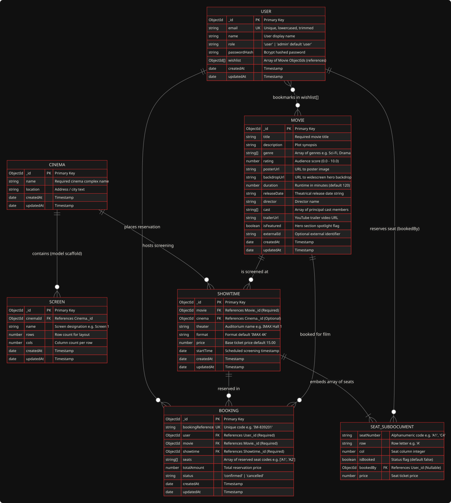
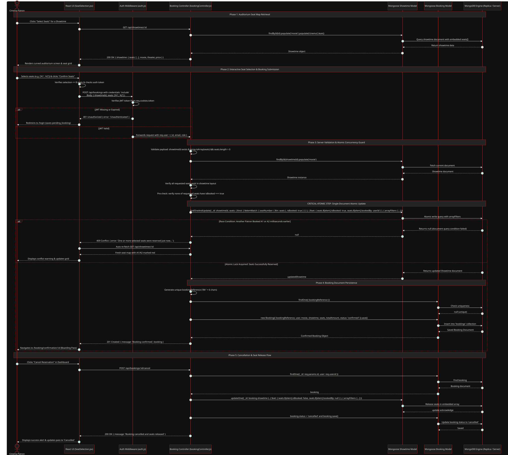

# iMovies — Complete Technical Architecture & System Documentation

Welcome to the definitive architecture documentation for **iMovies**, a full-stack MERN cinema discovery, seat selection, and ticket booking web application.

This documentation is derived strictly from the actual codebase implementation across the frontend (`frontend/`), backend (`backend/`), and persistence models (`backend/src/models/`).

---

## Table of Contents

1. [Project Overview & Architectural Summary](#1-project-overview--architectural-summary)
2. [Technology Stack](#2-technology-stack)
3. [Architecture Diagrams Index](#3-architecture-diagrams-index)
   - [Diagram 1: System Architecture](#diagram-1-system-architecture)
   - [Diagram 2: Technical Architecture](#diagram-2-technical-architecture)
   - [Diagram 3: Entity-Relationship Diagram (ERD)](#diagram-3-entity-relationship-diagram-erd)
   - [Diagram 4: Application User Journey Flow](#diagram-4-application-user-journey-flow)
   - [Diagram 5: Concurrency-Safe Booking & Reservation Flow](#diagram-5-concurrency-safe-booking--reservation-flow)
   - [Diagram 6: Backend Architectural Pattern](#diagram-6-backend-architectural-pattern)
   - [Diagram 7: Data Flow Diagrams (Level 0 & Level 1)](#diagram-7-data-flow-diagrams-level-0--level-1)
   - [Diagram 8: System Use-Case Diagram](#diagram-8-system-use-case-diagram)
4. [Component Deep-Dive](#4-component-deep-dive)
   - [Frontend Client & Design System](#frontend-client--design-system)
   - [Express Middleware Pipeline](#express-middleware-pipeline)
   - [Controllers & Domain Logic](#controllers--domain-logic)
   - [Data Modeling & Mongoose Schemas](#data-modeling--mongoose-schemas)
5. [Booking Concurrency & Transaction Boundary Analysis](#5-booking-concurrency--transaction-boundary-analysis)
6. [Implementation Status & Architecture Audit](#6-implementation-status--architecture-audit)
7. [Diagram Regeneration Instructions](#7-diagram-regeneration-instructions)

---

## 1. Project Overview & Architectural Summary

**iMovies** is a modern cinematic ticketing platform designed with a high-contrast dark aesthetic (`#101010` background, `#C62828` crimson accents, and `#F2EFE8` warm off-white typography).

The system consists of:
- **A Decoupled Client SPA**: Built with React 18 and Vite, using client-side routing (`react-router-dom` v6), responsive CSS modules, contextual authentication management (`AuthContext`), and interactive auditorium seat rendering with curved screens.
- **A RESTful API Service**: Built on Node.js and Express.js, featuring cookie-based JWT authentication, IP rate limiting, role-based authorization guards (`requireRole`), and a clean Route-Controller-Model architecture.
- **A MongoDB Persistence Engine**: Managed via Mongoose 9, utilizing a hybrid persistence strategy combining normalized collection references with embedded denormalized subdocuments (such as auditorium seating grids embedded directly inside showtimes).
- **Atomic Concurrency Protection**: High-throughput seat reservations protected against race conditions and double-booking through atomic single-document MongoDB queries (`findOneAndUpdate` with `$elemMatch` negation and positional `arrayFilters`).

---

## 2. Technology Stack

| Layer | Technology | Version | Purpose in Codebase |
| :--- | :--- | :--- | :--- |
| **Frontend Framework** | React | `^18.2.0` | Reactive component hierarchy, virtual DOM reconciliation |
| **Frontend Tooling** | Vite | `^5.2.0` | Fast HMR dev server (port 5173), ESBuild production bundler |
| **Routing** | React Router DOM | `^6.22.0` | Declarative SPA routing, URL search param synchronization |
| **Styling** | Vanilla CSS3 | Standard | Custom cinematic design tokens (`styles.css`), CSS variables |
| **Backend Runtime** | Node.js | `>= 18` (v24 tested) | Non-blocking asynchronous server runtime |
| **Web Framework** | Express.js | `^5.3.0` | HTTP pipeline, REST routing, error handling |
| **Database** | MongoDB | `>= 6.0` | Document-oriented NoSQL database |
| **ODM** | Mongoose | `^9.11.4` | Object Document Mapping, schema validation, population |
| **Authentication** | JSON Web Tokens (`jsonwebtoken`) | `^9.0.3` | Signed stateless session tokens transmitted via HTTP-only cookies |
| **Password Hashing** | Bcrypt | `^6.0.0` | Salted hashing (`saltRounds = 10`) for patron & admin passwords |
| **Cookie Parsing** | `cookie-parser` | `^1.4.7` | Secure extraction of incoming JWT session cookies |
| **Rate Limiting** | `express-rate-limit` | `^8.7.1` | Brute-force mitigation (100 req / 15 min on `/api/auth`) |
| **Input Validation** | `express-validator` | `^7.3.2` | Request body normalization and sanitization |
| **Testing** | Jest + Supertest | `^30.5.2` / `^7.3.1` | Automated integration tests for auth and atomic booking flows |
| **In-Memory Testing** | `mongodb-memory-server` | `^11.3.0` | Isolated zero-dependency MongoDB instance for test suites |
| **Diagram Generation**| `puppeteer-core` + Mermaid 10 | Headless | Automated rendering of diagrams into SVG graphics |

---

## 3. Architecture Diagrams Index

Every diagram below is rendered as a vector SVG (`.svg`) using a cinematic dark theme and is accompanied by its editable Mermaid source (`.mmd`).

---

### Diagram 1: System Architecture

The System Architecture diagram captures the end-to-end topology of iMovies, differentiating between development-time tooling (Vite Dev Server, proxying, and Jest test runner) and production runtime components (the browser client, Express API server, MongoDB persistence, and external content CDNs).

[](diagrams/system-architecture.svg)

- **Editable Source:** [`diagrams/system-architecture.mmd`](diagrams/system-architecture.mmd)
- **Key Characteristics:**
  - Clear delineation between client runtime, dev-time tooling, API server layers, and database collections.
  - Directional data flows showing API requests with credentials and external media streaming from Unsplash and YouTube.

---

### Diagram 2: Technical Architecture

The Technical Architecture diagram maps out the precise codebase structure, linking specific file paths, React components, and router endpoints on the frontend directly to their corresponding Express routes, middleware, controllers, and Mongoose model files on the backend.

[](diagrams/technical-architecture.svg)

- **Editable Source:** [`diagrams/technical-architecture.mmd`](diagrams/technical-architecture.mmd)
- **Key Characteristics:**
  - Traces execution from `main.jsx` and `App.jsx` through `api.js` over HTTP to `backend/src/index.js`.
  - Details the routing chain through `routes/`, `middleware/`, `controllers/`, and `models/`.

---

### Diagram 3: Entity-Relationship Diagram (ERD)

The ER diagram illustrates the MongoDB collections, fields, primary identifiers, foreign keys, and cardinalities as defined in the Mongoose schemas (`User.js`, `Movie.js`, `Cinema.js`, `Screen.js`, `Showtime.js`, and `Booking.js`).

[](diagrams/entity-relationship.svg)

- **Editable Source:** [`diagrams/entity-relationship.mmd`](diagrams/entity-relationship.mmd)
- **Key Characteristics:**
  - Highlights the embedded `seats` subdocument array within `Showtime`.
  - Documents foreign key references (`ref: 'Movie'`, `ref: 'Cinema'`, `ref: 'User'`).
  - Represents the `wishlist` array of `ObjectId` references on the `User` document.

---

### Diagram 4: Application User Journey Flow

The User Flow diagram maps the complete interactive path of a cinema patron, including movie discovery, searching, genre filtering, auditorium seat picking, authentication branches, booking conflict handling, and cancellation.

[](diagrams/user-flow.svg)

- **Editable Source:** [`diagrams/user-flow.mmd`](diagrams/user-flow.mmd)
- **Key Characteristics:**
  - Captures the decision branch when an unauthenticated patron reserves a seat: the application stores `pending_booking` in `localStorage`, redirects to `/login`, and returns back to seat selection.
  - Visualizes the 409 Conflict branch when a seat is reserved concurrently by another patron.

---

### Diagram 5: Concurrency-Safe Booking & Reservation Flow

This sequence diagram depicts the detailed step-by-step communication between the Client UI, Auth Middleware, Booking Controller, Mongoose Models, and MongoDB during seat reservation and cancellation.

[](diagrams/booking-reservation-flow.svg)

- **Editable Source:** [`diagrams/booking-reservation-flow.mmd`](diagrams/booking-reservation-flow.mmd)
- **Key Characteristics:**
  - Details the exact atomic query executed on the `Showtime` collection:
    ```javascript
    Showtime.findOneAndUpdate(
      {
        _id: showtimeId,
        seats: {
          $not: {
            $elemMatch: { seatNumber: { $in: seats }, isBooked: true }
          }
        }
      },
      {
        $set: {
          'seats.$[elem].isBooked': true,
          'seats.$[elem].bookedBy': req.user.id
        }
      },
      {
        arrayFilters: [{ 'elem.seatNumber': { $in: seats } }],
        returnDocument: 'after'
      }
    )
    ```
  - Shows how race conditions are handled with HTTP 409 Conflict responses.
  - Documents the seat release flow upon reservation cancellation.

---

### Diagram 6: Backend Architectural Pattern

This diagram explains the structural design of the backend service. It documents that iMovies does not follow a traditional server-side rendered MVC pattern, but rather a **Layered Route-Controller-Model REST API Architecture with an Express Pipeline Middleware Chain**.

[](diagrams/backend-architecture.svg)

- **Editable Source:** [`diagrams/backend-architecture.mmd`](diagrams/backend-architecture.mmd)
- **Key Characteristics:**
  - Depicts the staged request lifecycle: Global Middleware -> Route Dispatcher -> Route Security Guards -> Controller Logic -> Mongoose Data Layer -> Database -> Standardized JSON Response / Central Error Handler.

---

### Diagram 7: Data Flow Diagrams (Level 0 & Level 1)

These diagrams illustrate the data flows across external entities, processes, and persistent data stores.

#### Level 0: Context Diagram
Captures the primary external actors (Patron, Administrator, Media CDNs) interacting with the black-box iMovies system boundary.

[](diagrams/data-flow-level-0.svg)

- **Editable Source:** [`diagrams/data-flow-level-0.mmd`](diagrams/data-flow-level-0.mmd)

#### Level 1: Decomposition Diagram
Decomposes the system into 6 core processes (`1.0 Auth`, `2.0 Movies`, `3.0 Showtimes`, `4.0 Seat Reservation`, `5.0 Bookings & Cancellation`, `6.0 Admin`) and 5 data stores (`D1 Users`, `D2 Movies`, `D3 Cinemas`, `D4 Showtimes`, `D5 Bookings`).

[](diagrams/data-flow-level-1.svg)

- **Editable Source:** [`diagrams/data-flow-level-1.mmd`](diagrams/data-flow-level-1.mmd)

---

### Diagram 8: System Use-Case Diagram

The Use-Case diagram details all capabilities implemented for the three supported system actors: **Guest** (Unauthenticated), **Registered Patron** (Authenticated Member), and **Studio Administrator** (Executive Role).

[](diagrams/use-case.svg)

- **Editable Source:** [`diagrams/use-case.mmd`](diagrams/use-case.mmd)
- **Key Characteristics:**
  - Shows role inheritance (`User` inherits `Guest`; `Admin` inherits `User`).
  - Represents `<<include>>` and `<<extend>>` dependencies between reservation, login, and cancellation workflows.

---

## 4. Component Deep-Dive

### Frontend Client & Design System

The frontend is structured as a single-page application under `frontend/src/`:
- **State Management**:
  - `context/AuthContext.jsx`: Maintains authenticated user state (`user`, `loading`), verifies existing sessions via `GET /api/auth/profile`, and exposes `login()`, `register()`, and `logout()` methods.
- **Network Layer**:
  - `api.js`: Unified wrapper around the browser `fetch` API. Automatically specifies `credentials: 'include'` to pass HTTP-only session cookies and parses error responses into standardized JavaScript `Error` objects with HTTP status attachments.
- **Cinematic Design System**:
  - Root CSS tokens defined in `styles.css`:
    - Canvas Background: `--bg-primary: #101010`
    - Surfaces: `--bg-secondary: #191919`, `--bg-card: #1A1A1A`
    - Accent: `--accent: #C62828` with glowing box-shadows (`--accent-glow`)
    - Typography: Google Fonts **Outfit** for clean sans-serif UI, paired with **Playfair Display** for cinematic editorial titles.
    - Custom scrollbars styled in dark slate and crimson.

### Express Middleware Pipeline

Requests entering `backend/src/index.js` pass through a sequential pipeline:
1. **CORS Guard**: Configured with dynamic origin matching (`http://localhost:5173`, `http://127.0.0.1:5173`, and `process.env.FRONTEND_URL`) with `credentials: true`.
2. **Cookie Parser**: Reads the signed HTTP-only `token` cookie.
3. **JSON Parser**: Parses incoming JSON payloads (`express.json()`).
4. **Rate Limiter (`rateLimiter.js`)**: Applies a sliding window limit of 100 requests per 15 minutes per IP address to all routes under `/api/auth` to prevent credential stuffing.
5. **Authentication Middleware (`auth.js`)**: Extracts and verifies the JWT token using `process.env.JWT_SECRET`. Populates `req.user = { id, email, role }`. Returns HTTP 401 if absent or invalid.
6. **Role Guard (`requireRole.js`)**: Higher-order middleware factory verifying `req.user.role === expectedRole`. Returns HTTP 403 Forbidden on privilege mismatch.
7. **Centralized Error Handler (`errorHandler.js`)**: Catches all errors propagated through `next(err)`. Logs error stacks server-side while masking internal database errors as generic messages in production.

### Controllers & Domain Logic

- **`authController.js`**: Handles registration with `express-validator` schema checks, password hashing via `user.setPassword(password)`, session cookie creation with `httpOnly`, `secure`, and `sameSite` configuration, and user profile queries.
- **`movieController.js`**: Supports multi-field case-insensitive regex search (`title`, `description`, `director`), genre filtering, sorting (`rating`, `latest`), pagination, and administrative CRUD operations. Enforces cascade deletion of associated showtimes when a movie is removed (`Showtime.deleteMany({ movie: id })`).
- **`wishlistController.js`**: Manages the user's bookmarked films by atomically pushing and filtering ObjectIds on `user.wishlist` and returning populated movie objects.
- **`showtimeController.js`**: Generates structured 2D seating grids (`generateSeats(rows, cols, price)`) with alphanumeric seat codes (rows A–J, numbered columns), pricing, and default unbooked states.
- **`bookingController.js`**: Coordinates atomic seat locking, unique reference generation (`IM-XXXXXX`), booking persistence, and cancellation with automatic seat freeing.
- **`adminController.js`**: Aggregates box office metrics using `Promise.all` count queries and confirmed booking revenue summations, lists recent patron reservations, and manages cinema complexes.

### Data Modeling & Mongoose Schemas

- **`User`**: Contains email, name, role (`'user'` or `'admin'`), hashed password, and an array of `Movie` references in `wishlist`.
- **`Movie`**: Contains full cinematic metadata, genres, rating, duration, release date, cast, director, trailer URLs, and the `isFeatured` spotlight flag.
- **`Cinema`**: Represents a theatrical venue name and geographic location.
- **`Screen`**: Schema scaffold specifying `cinemaId`, name, rows, and cols.
- **`Showtime`**: Represents a scheduled screening for a specific movie in a theater. Contains an embedded array of seat subdocuments (`seatNumber`, `row`, `col`, `isBooked`, `bookedBy`, `price`).
- **`Booking`**: Represents a confirmed or cancelled reservation pass with unique `bookingReference`, referencing the patron (`User`), `Movie`, and `Showtime`, along with selected seat labels and `totalAmount`.

---

## 5. Booking Concurrency & Transaction Boundary Analysis

### Single-Document Atomic Reservation
A critical challenge in cinema ticketing platforms is avoiding double-booking when multiple patrons attempt to reserve the same seat simultaneously.

iMovies solves this using MongoDB's single-document atomicity:
1. When a booking request arrives at `POST /api/bookings`, the controller validates that the requested seats exist in the showtime layout.
2. An atomic `findOneAndUpdate` operation is executed directly on the `Showtime` document:
   ```javascript
   const updatedShowtime = await Showtime.findOneAndUpdate(
     {
       _id: showtimeId,
       seats: {
         $not: {
           $elemMatch: {
             seatNumber: { $in: seats },
             isBooked: true,
           },
         },
       },
     },
     {
       $set: {
         'seats.$[elem].isBooked': true,
         'seats.$[elem].bookedBy': req.user.id,
       },
     },
     {
       arrayFilters: [{ 'elem.seatNumber': { $in: seats } }],
       returnDocument: 'after',
     }
   );
   ```
3. **Race Condition Prevention**: The query predicate matches the showtime document **only if none** of the target seats currently have `isBooked: true`.
4. If two concurrent requests arrive for seat `A1`, MongoDB executes write locks per document sequentially. The first write succeeds and sets `A1.isBooked = true`. The second write evaluates the predicate, sees that `A1` is booked, fails to match the document, and returns `null`.
5. The controller inspects `if (!updatedShowtime)` and immediately returns an HTTP **409 Conflict** response. The frontend receives this status, warns the user, and auto-refreshes the seat layout.

### Transaction Boundary Observations
- **Strengths**: This approach is concurrency-safe and requires no external distributed locks (e.g. Redis Redlock) or heavy database table locks.
- **Architectural Boundary**: The reservation modifies two collections: it atomically reserves seats in `Showtime`, and then calls `booking.save()` in `Booking`. The implementation does not wrap these two steps in a multi-document replica-set transaction (`session.withTransaction()`). In the edge case where the Node.js process crashes between the showtime update and the booking document creation, the seats would remain flagged as reserved in the showtime without a corresponding booking record. In production, wrapping this multi-document write in a Mongoose session transaction would guarantee strict ACID rollback across collections.

---

## 6. Implementation Status & Architecture Audit

During the inspection of the codebase in Phase 1, the following findings and implementation nuances were recorded:

| Component / Feature | Intended / Expected | Actual Code Implementation | Architectural Assessment |
| :--- | :--- | :--- | :--- |
| **Backend Architecture** | Traditional MVC | Layered Route-Controller-Model REST API | Accurate. There are no server-rendered views; views are strictly managed by the React 18 SPA. |
| **Service Layer** | Separate `services/` layer | Logic embedded directly in controllers | Normal for lightweight Express backends. Business logic resides in controller methods. |
| **Screen Model** | Standalone screen collection queries | `Screen.js` model exists, but is unreferenced in routes | `showtimeController.js` accepts `rows` and `cols` in request bodies and generates seats inline rather than referencing a `Screen` entity. |
| **Cinema Fields** | Schema specifies `name` and `location` | `adminController.createCinema` accepts `{ name, address, city }` | Mongoose drops undefined schema properties unless strict mode is disabled. In seed data, address and city are populated directly. |
| **Payment Integration** | Real payment gateway (Stripe/PayPal) | Demo Reservation Mode | Code explicitly handles bookings without an external payment SDK (`$0.00 Booking Fee (Demo Mode)`), generating valid MongoDB records immediately upon confirmation. |
| **Cascade Deletions** | Movie deletion cascades to showtimes | Implemented in `movieController.js` | When a movie is deleted, `Showtime.deleteMany({ movie: movie._id })` cleans up orphaned screenings. |
| **Automated Tests** | Integration test suite | Jest + Supertest (`booking.test.js`, `auth.test.js`) | 8/8 tests passing with isolated in-memory MongoDB database. Validates registration, movie listing, atomic reservation, 409 double-booking rejection, and cancellation. |

---

## 7. Diagram Regeneration Instructions

All architecture diagrams can be regenerated automatically at any time using the bundled generator script.

### Prerequisites
- Node.js installed (`node -v` >= 18)
- A Chromium-based browser installed on the host system (Google Chrome or Microsoft Edge)

### One-Command Generation
From the root of the repository, run:
```bash
npm run docs:generate
```

### Direct Script Execution
Alternatively, execute the standalone Node.js script:
```bash
node docs/scripts/render-diagrams.js
```

### How the Script Works
1. Scans `docs/diagrams/` for all `.mmd` Mermaid source files.
2. Boots a headless browser instance via `puppeteer-core` connected to the local Chrome/Edge executable.
3. Injects Mermaid 10 and compiles each diagram using the custom iMovies cinematic color palette (`#101010`, `#191919`, `#C62828`, `#F2EFE8`).
4. Injects a dark background `<rect>` with rounded corners to ensure crisp readability in GitHub's dark and light markdown viewers.
5. Outputs standard `.svg` vector files into `docs/diagrams/`.
